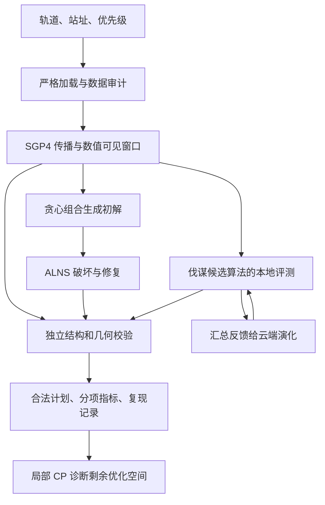

# 方案 E 初版：从赛题理解到可运行调度程序

本文对应 2026 年 10 月 20 日的初版实现。它已经能够读取真实轨道和地面站数据，计算观测机会，生成合法计划，并使用百度伐谋搜索更好的调度策略。全量基础程序与伐谋小规模候选分别有实验记录；动态状态闭环、产品界面和正式比赛评分适配尚未完成。

这里的“方案 E”是本项目的交付名称，不代表已经训练出一个名为 E 的模型，也不代表已证明算法新颖性。阅读顺序是：先理解业务与规则，再看数学模型、求解流程、实验结果和代码入口。

## 1. 题目究竟要解决什么

地面站可以把望远镜理解成一台只能依次服务任务的设备。某个空间目标经过某个站上空时，会产生一段“能看见、且仰角满足设备限制”的时间。这个时间段叫**可见窗口（visibility window）**。

能看见并不等于可以安排：同一站不能同时看两个目标；从一个目标切换到另一个目标需要时间；每次观测还必须持续足够久。因此，任务不是给目标简单排序，而是同时决定：

1. 观察哪些目标；
2. 每个目标交给哪个地面站；
3. 选择哪一次过境、何时开始；
4. 观察多长时间；
5. 在站点或任务状态变化后，哪些计划应保留、哪些需要重排。

其中第 1—4 项已形成可运行的静态规划链路。第 5 项属于后续要补齐的动态闭环。目前不能把“已有局部修复器”直接称为“动态监测和重规划产品已经完成”。

### 1.1 已经确认的规则

实际材料包括题目正文、补充说明，以及轨道、站址、优先级文件。核对结果如下：

| 内容 | 材料支持的要求 | 对程序的影响 |
|---|---|---|
| 实例规模 | 10,000 个目标、10 个地面站、共 6 天 | 必须分块计算和控制内存 |
| 优先级 | 高、中、低分别为 5、3、2 分 | 同样观测时间对应不同收益 |
| 观测时长 | 至少 120 秒；120 秒得 60%；240 秒及以上得 100% | 覆盖更多目标与延长观测存在取舍 |
| 站点资源 | 一个站同时只能观测一个目标 | 所有任务必须检查站内冲突 |
| 切换时间 | 切换目标需要 30 秒 | 两个不同目标之间需要空出间隔 |
| 仰角 | 全程位于 10°—85° | 不能仅检查开始和结束时刻 |
| 优化方向 | 尽可能覆盖更多目标并获得更高观测分 | 两项指标分别报告 |
| 完整系统 | 包括状态更新和动态重规划 | 静态排程只是第一阶段 |
| 计算方式 | 要有真实计算、规划和校验程序 | 文本生成不能替代实际求解 |

特别注意，240 秒是得分饱和点，材料没有说超过 240 秒就违法。初版主要考虑 120/240 秒，是为减少无收益的占用而采用的搜索策略。

### 1.2 必须公开的开发假设

材料尚未明确：重复观测是否累计计分、每个目标能否多次观测、统一起始时刻、120—240 秒之间如何计分，以及日夜或光照条件。初版因此显式选择：

- 从 `2026-08-04T00:00:00Z` 开始，靠近输入 TLE 的历元；
- 每个目标最多观测一次；
- 先最大化覆盖目标数，再最大化观测分；
- 中间时长保守保持 60%，线性插值仅作为可选配置；
- 不自动增加“48 小时重复间隔”“太阳高度低于 −6°”或天气过滤。

这些选择会改变问题难度，尤其“单次观测、没有日夜过滤”的六天实例比较宽松。它们不是已确认的正式规则。

补充说明中的计算结果 40%、产品体验 30%、算法效率 30%，合计基础评价 100%；题目正文另有一套 25/25/25/15/10 的评价划分，两者的关系尚待确认。后面的 **30,057.6 是观测权重分，不是比赛百分制总分**。完整来源见[数据审计](research/2026-10-20-data-audit.md)。

## 2. 为什么先处理数据和几何，再讨论 AI

如果目标编号匹配错了，优化器可能把低优先级目标当成高优先级；如果过境窗口算错了，再高的分数也可能对应无法执行的计划。第一步因此是建立可信输入。

实际 `轨道.txt` 并不是普通轨道根数表，而是 10,000 个三行记录：名称行加两行 **TLE（Two-Line Element，双行轨道根数）**。20,000 行轨道数据的长度和校验和全部通过。目标中有 108 个 Alpha5 编号，需要按标准转换，不能直接删除字母。高、中、低优先级目标分别有 2,024、3,990、3,986 个，分组没有缺漏或交叉。

站址文件混用了负经度与 0—360° 经度，还存在全角标点；优先级文件是单行逗号分隔。加载器处理这些格式，检查重复、缺漏和非法数值，失败时给出结构化审计结果，不静默返回残缺数据。

在“每目标一次且全部满分”的口径下，理论权重总和为：

$$
P=2024\times5+3990\times3+3986\times2=30062.
$$

这个数只是理想分母。目标可能没有足够长的窗口，或与其他任务冲突，不能假定它全部可达。

### 2.1 从 TLE 到可见窗口

**轨道传播（orbit propagation）**就是根据 TLE 计算目标在后续各时刻的位置。程序使用 SGP4，然后把目标位置转换到与地面站一致的坐标表示，再计算站点看向目标的仰角。

对目标 \(i\)、站点 \(j\)，合法窗口是满足下式的连续时间区间：

$$
W_{ij}=\{t:10^\circ\le e_{ij}(t)\le85^\circ\}.
$$

85° 上界不能省略。一个目标从地平线上升、接近天顶、再下降时，接近天顶的一段可能超限，原本连续的过境必须拆成两个窗口。

实现先用默认 30 秒步长定位事件，再检查仰角变化率、细化极值，求出穿越 10° 和 85° 的时刻。根的时间容差为 0.01 秒，交点边界向内收缩以减少舍入越界。短于 120 秒的物理窗口仍保留，由调度器决定是否能够使用。**30 秒是事件搜索步长，不是把任务开始时间限制在每隔 30 秒的格点上。**

采用 TLE 常用的 WGS72 传播常数、TEME 输出和 WGS84 站址模型；当前取 UT1=UTC，没有加入极移、折射、真实天气或 TLE 不确定性。这是开发阶段几何模型，不是已有实测指向精度保证的观测控制系统。

有限步长扫描与数值极值细化也不是解析完备性证明。我们用 200 目标、10 站的 1 天和 6 天实例比较 30/15 秒步长：窗口数分别完全一致，最大边界差小于 0.008 秒。这提供了敏感性证据，不能推导出任意轨道或全量数据均绝不会漏窗。

### 2.2 为什么能够处理万级目标

轨道状态按“目标块×时间块”计算，同一位置、速度和地固转换在 10 个站之间复用，避免每个站重复传播。窗口支持缓存、多进程与跨块合并，也没有构建所有候选之间的巨大两两冲突矩阵。

传播返回非零错误码时，对应片段不能成为合法窗口；程序记录错误，不把目标从覆盖分母删除。全量实验发现一个目标在后段出现 SGP4 错误码 6，相关片段被排除，但其早期仍有合法观测机会。这个返回码描述传播模型状态，不能证明真实再入时间。更多细节见[几何方法](research/2026-10-20-geometry-method.md)。

## 3. 初版怎样把问题写成数学模型

直观上，每个可见窗口是一段可供选择的时间资源。调度器在其中放入一个至少 120 秒的任务，并保证它不挤占同站其他任务或切换间隔。

设目标权重为 \(p_i\)，规划长度为 \(H\)。选择某个目标的站点与窗口后，任务具有连续开始时刻 \(s_i\) 和时长 \(d_i\)，结束时刻为 \(s_i+d_i\)。窗口为 \([a_{ijk},b_{ijk}]\)，其中 \(k\) 区分同一目标与站点的不同过境。

| 约束 | 当前模型的含义 |
|---|---|
| 窗口完整包含 | \(a_{ijk}\le s_i,\ s_i+d_i\le b_{ijk}\) |
| 时长和规划范围 | \(d_i\ge120,\ 0\le s_i<s_i+d_i\le H\) |
| 同站不重叠 | 同站两任务必须存在合法先后顺序 |
| 不同目标切换 | 前一任务结束后至少 30 秒才能开始后一任务 |
| 每目标次数 | 当前开发设置最多一次；这是可配置假设 |
| 全程几何 | 任务整个区间均满足仰角上下界 |

默认阶梯计分函数为：

$$
f(d)=
\begin{cases}
0.6,&120\le d<240,\\
1,&d\ge240.
\end{cases}
\qquad
C=\sum_i y_i,\quad S=\sum_i y_i p_i f(d_i),
$$

其中 \(y_i=1\) 表示安排了目标 \(i\)。优化目标为字典序最大化 \((C,S)\)：先比较 \(C\)，只有覆盖数相同才比较 \(S\)。它叫**覆盖优先（coverage first）**，并不是“覆盖和得分各占 50%”。

例如，多覆盖一个目标但总观测分稍低，在当前目标下仍被认为更好。因此，只写一个“分数提高”的结论会掩盖取舍，实验始终同时列出覆盖数和观测分。

这里描述的是连续时间问题。贪心和局部搜索选择有限的插入位置与时长组合，属于启发式；后面的 CP-SAT 诊断进一步使用整秒起点和初解锚点，属于受限局部模型。三者的最优性范围不能混用。

## 4. 第一条求解路线：可靠初解、局部改进、独立校验

### 4.1 贪心组合：先快速得到几份像样的计划

**贪心（greedy）**每次根据当前信息选择一个值得安排的任务，不枚举所有未来组合。初版组合了五种构造思路：机会稀缺优先、高优先级优先、最早截止优先、后悔值插入、优先安排满分时长。

“稀缺优先”保护只有少数机会的目标；“后悔值”关注错过当前最佳位置后，会损失多少替代选择。它们各有偏好，所以先产生多份计划，再按同一目标选最好的一份。放置任务时检查相关窗口和站点空隙，随后在不破坏其他任务的条件下尝试延长观测。

这一步是强基线，也是后续算法的合法初解。不是只写一个很弱的排序器，再把复杂方法的优势夸大为 AI 收益。

### 4.2 ALNS：拆掉一部分，重新安排

**自适应大邻域搜索（Adaptive Large Neighborhood Search，ALNS）**的直觉是：排好的任务可能相互卡住，单独移动一个没有用；把一小片任务临时撤下来，再一起安排，可能腾出新空间。

初版包含随机、相关性和较差任务移除等破坏方式，以及多种插入修复。算法依据历史表现调整算子权重；允许中性移动和模拟退火接受，以免只接受即时变好而被局部最优困住。同时保留历史最好合法计划，搜索走弯路不等于最终结果退化。

这里的“自适应”确实在运行时改变搜索选择，但没有训练神经网络。它是已有优化技术的工程实现，不能仅凭带有自适应机制就声称研究创新。

### 4.3 独立校验：让生成计划与判定合法分开

调度器自己的插入检查可能有漏洞，因此另写 `validation.py`，不调用调度器的可行性判定逻辑。它检查：

- 标识、有限数值、规划范围、最短时长和次数上限；
- 整个观测是否位于同一个物理窗口内；
- 同站重叠，包括一个长任务跨越多个短任务的嵌套情况；
- 不同目标的 30 秒切换间隔；
- 重新传播任务段，以不超过 5 秒间隔检查，并细化局部极值。

只有实际重算几何后，才能报告 `geometry_checked=true`。不传几何对象的结构检查不能冒充完整通过。它与窗口模块共用物理传播模型，所以独立程序逻辑能够发现排程错误，却不能消除双方共有的物理近似。测试还通过公开轨道与另一坐标计算路径对照，检查单位、旋转方向等问题。

## 5. 为什么研究过“联合修复”，但暂时没有训练模型

设两个站点时间块 A、B 被占满。单独释放 A 或 B 可能没有收益，联合释放两者却可能形成跨站交换链，多安排一个目标。我们曾考虑学习预测这类“必须一起改才有效”的邻域。

**约束规划 CP-SAT**用于验证这种可能性：固定块外任务，只在局部块内重排，同时允许原先未覆盖的目标进入。为限制规模，起点使用整秒变量，并保留原计划的精确分数秒锚点，避免取整反而删掉初解。候选超过上限时跳过整个诊断，不偷偷裁剪后宣称解了完整问题。

用 \(G(A)\) 表示释放 A 后的最佳改善，联合额外收益定义为：

$$
R(A,B)=G(A\cup B)-G(A)-G(B).
$$

若只求得改善上下界 \([L,U]\)，则：

$$
R\in[L_{AB}-U_A-U_B,\ U_{AB}-L_A-L_B].
$$

只有区间下界大于零，才认证这个固定局部模型存在正交互。超时没找到改善不能标记为“没有改善”。局部求解器的上界也不能用于证明原连续时间全局问题最优。

合成小例子能够产生正交互，但真实拥塞实例的已完成抽样中，尚无认证为正的联合额外收益。较细时间块的 12 组诊断有 2 组联合找到改善，却仍是 11 组交互非正、1 组不确定。这说明经典修复有用，尚不能说明训练交互模型有价值，也不能证明交互不存在。

先前文献分析还发现 learned LNS、收益预测、LLM 演化搜索算子等均已有相关工作。因此暂缓训练的理由是：**还没有证明需要学习的瓶颈及其独立收益**。详细定义和证据见[局部修复说明](research/2026-10-20-validation-local-repair.md)与[前期路线分析](research/2026-10-19-ai-innovation-route.md)。

## 6. 第一阶段真实运行到了什么程度

### 6.1 全量结果

在上述开发假设下，10,000 目标、10 站、6 天共产生 **2,250,812 个数值窗口**。贪心组合和三个 ALNS 种子的最好结果均为：

| 指标 | 结果 |
|---|---:|
| 覆盖目标 | 10,000 / 10,000 |
| 观测权重分 | 30,057.6 |
| 当前数值窗口模型的乐观得分上界 | 30,059.2 |
| 与上界的差 | 至多 1.6 |
| 冷窗口计算 | 717.34 秒 |
| 贪心求解 | 64.40 秒 |
| 每个 ALNS 的额外软预算 | 约 60 秒 |
| 完整实验端到端 | 1,088.38 秒，约 18.14 分钟 |

乐观上界的计算先忽略站点之间的任务竞争，让每个目标独立选择自己的最好窗口，所以它可能不可同时达到；它还只针对当前数值窗口模型。它低于理想权重和 30,062，因为部分目标无法获得 240 秒窗口。

完整时间包含窗口计算、输出、一次贪心、三次 ALNS 与四次独立校验。测试机器为 Apple M5、10 核 CPU、16 GiB 内存，窗口计算使用 4 个工作进程，没有使用 GPU。主进程峰值约 1,813 MiB，不是所有工作进程同时内存的合计。

全部四份计划通过独立结构与数值几何校验。ALNS 在 60 秒内完成的实际迭代分别为 12、18、13 次，没有达到配置的 100 次，也没有改善全量结果。此时再承诺 2%—3% 的分值提升不合理，因为模型上界只剩 1.6 分。

### 6.2 用拥塞开发实例检查搜索能力

为制造资源竞争，另取真实目标子集，缩短时域、减少站点。它们是开发场景，不是修改后的正式赛题。

| 场景 | 贪心组合 | 第一阶段 ALNS |
|---|---|---|
| 200 目标、10 站、1 天 | 200 覆盖 / 600 分 | 三个种子均为 200 / 600 |
| 1,000 目标、3 站、3 小时 | 190 / 358.8 | 覆盖 191—194；不同种子得分 450.6—549.2 |
| 300 目标、2 站、1 小时 | 44 / 84 | 均覆盖 44，最好次项为 108 |

300 目标例再用 60 秒局部 CP 得到 46 覆盖 / 90 分，证明存在更多覆盖的合法解，但次项下降，不能称为两个指标同时改进。受限模型当次只证明最优覆盖位于 46—48，没有证明最优。

第一阶段 130 项测试通过；200 目标实例复跑的四份完整任务列表逐项一致。后续伐谋接入完成时，记录的总测试数扩展到 182。测试数量是对应阶段记录，本次发布的实际检查结果应另以发布记录为准。全部细节见[第一阶段实验](research/2026-10-20-stage1-results.md)。

## 7. 百度伐谋实际做了什么

### 7.1 它是算法搜索工具，不负责替代物理计算

接入采用“云端生成候选代码，本地评测”的混合云方式。给伐谋一个初始调度算法和优化要求；它生成改版，本地用真实窗口运行、独立检查、返回汇总指标；云端依据反馈继续演化。

云端上传回执只有 `init.py`、`prompt.md` 和 `config.yaml`。原始轨道、站址、优先级、窗口、计划和评测器均留在本地。候选接口为 `solve(instance)`：输入窗口、规则、权重和种子，输出任务列表。最终选中的 Python 算法能够脱离伐谋独立运行，不要求每次生成计划都调用云端。

为了让单个数值保留覆盖优先，反馈使用：

$$
\text{combined\_score}
=\frac{C+S/(P+1)}{N+1},
$$

其中 \(N\) 为目标数，\(P\) 为权重和。合法单次观测时 \(S/(P+1)<1\)，因此多覆盖一个目标始终优于任何次项变化。这个值是演化排序分，不是比赛成绩。

候选在独立进程内运行，每例上限 20 秒。当前 macOS 实现限制读取本地资料、联网、启动子进程和写出位置；worker 拒绝云端附加依赖，并再次核对合法性。没有 RAM 硬上限，因此采用单并发，不宣称完全资源隔离。密钥不属于项目交付文件。

### 7.2 10 轮演化产生了什么

云端任务完成 10 轮，运行约 742 秒；下载 14 个榜单条目，对应 11 份不同源码，逐一进行了本地复评。账号余额实际减少 **4,187 资源点**，这是余额变化记录。

初始单文件算法已包含贪心组合和 180 次破坏修复，它与第一阶段模块化 ALNS 的实现及预算不同。选中候选主要增加或强化了：

- 按站点和时间邻近关系移除任务；
- 多种重新插入顺序；
- 利用任务左右空隙延长观测；
- 模拟退火接受，帮助搜索离开局部最优；
- 2,500 次固定搜索迭代。

取回后发现，字符串集合顺序随进程变化，会影响固定随机种子的站点选择。本地将站点集合排序后再抽样，保留原始云端源码。修复后 300 目标例连续三次独立进程的完整任务列表相同。

| 开发实例 | 此次云端上传的初始算法 | 选中候选经确定性修复 |
|---|---|---|
| 300 目标、2 站、1 小时；参与云端反馈 | 46 覆盖 / 91.4 分 | **48 覆盖 / 111.6 分** |
| 1,000 目标、3 站、3 小时；未参与此次云端反馈 | 203 覆盖 / 408.6 分 | **212 覆盖 / 518.0 分** |

两份最终计划均通过独立约束与几何校验。300 目标例的覆盖达到容量上界：每站 \(120n+30(n-1)\le3600\)，故每站最多 24 个、两站最多 48 个；这不证明观测分 111.6 最优。

两算法虽都有 20 秒执行上限，但一个搜索 180 次、另一个 2,500 次，不能据此证明同计算量下更好。1,000 目标例是额外场景检查，不是严格独立的统计泛化证明。候选尚未替换全量默认求解器，也没有在完整六天实例上证明收益。

因此伐谋已证明的作用是：**生成了可执行、可独立验证且在两个拥塞开发实例中更好的算法版本。** 当前没有训练新的调度模型；“用 AI 改进了代码”也不能单独完成最终程序 AI 能力或研究创新的验收。接入和复评记录见[伐谋报告](research/2026-10-20-famou-integration.md)。

## 8. 新成员应该从哪些文件开始

本文件夹是可独立安装的初版代码目录。下面路径均相对本方案根目录。

| 文件或目录 | 职责与阅读目的 |
|---|---|
| [README.md](../README.md) | 安装、数据位置、运行和复现入口 |
| [types.py](../src/space_planner/types.py) | 目标、站点、窗口、任务、规则的数据结构 |
| [data.py](../src/space_planner/data.py) | 严格加载、Alpha5、校验和、优先级与站址审计 |
| [geometry.py](../src/space_planner/geometry.py) | 传播、坐标、窗口事件、分块与缓存 |
| [scheduling.py](../src/space_planner/scheduling.py) | 计分、贪心组合、ALNS 和搜索轨迹 |
| [validation.py](../src/space_planner/validation.py) | 与生成逻辑分开的结构及数值几何检查 |
| [local_repair.py](../src/space_planner/local_repair.py) | CP-SAT 局部修复、界与交互诊断 |
| [cli.py](../src/space_planner/cli.py) | 读取配置、组织流程、写入计划和 manifest |
| [configs/](../configs/) | 子集、拥塞、全量实例及开发假设 |
| [integrations/famou/](../integrations/famou/) | 上传初始算法、云端要求、接口和接入说明 |
| [selected_candidate.py](../integrations/famou/selected_candidate.py) | 本次最终候选及确定性修复 |
| [famou_evaluator.py](../src/space_planner/famou_evaluator.py) | 候选隔离执行、真实实例评分和独立校验 |
| [scripts/](../scripts/) | 几何审计、真实探针、worker、复评和计划导出 |
| [tests/](../tests/) | 合成机制、异常、隔离边界及可行性测试 |

每次运行会生成 `manifest.json`、审计、窗口、计划和摘要。manifest 记录实际配置、输入和代码哈希、依赖、种子、预算及机器信息。任务的 `start/end` 是相对配置 UTC 起点的秒数。计划 JSON 同时保留指标与校验状态，便于从“输出了一个分数”追溯到“实际安排了哪些任务、为何合法”。

原始资料、凭证、虚拟环境和大体积生成结果不随代码提交。先按 README 放置授权数据、安装依赖，运行合成测试和 200 目标例，再选择全量实验；普通本地求解无需伐谋密钥。云端演化会消耗资源点，应与日常本地复评区分。

## 9. 初版之后真正需要完成的工作

首先应确认正式计分、重复观测、时间范围和光学照明规则。它们可能改变问题性质，不能在错误假设上不断优化。

随后补齐事件与状态闭环：输入站点故障、优先级变化等事件，更新任务状态，固定已经执行或不能变动的任务，对剩余时域重排，并报告恢复覆盖、响应时间及计划改动数。没有真实动态资料时，事件必须标成开发模拟。

算法比较要统一初解、候选、在线时间、线程数和调参预算；将手工 ALNS、经典交换链、局部 CP 与伐谋候选放到同一评测框架中。尤其应拆开“搜索更多次”与“策略更有效”的贡献，再判断是否需要训练收益预测模型。

最后完成可操作的界面、结果解释、导出与演示，把标准结果和可选环境场景分开验收。初版已经提供了真实输入到合法观测计划的计算基础，以及一次完成闭环的伐谋算法演化实验；后续工作的重点是正式条件、动态能力和可归因的算法收益。
