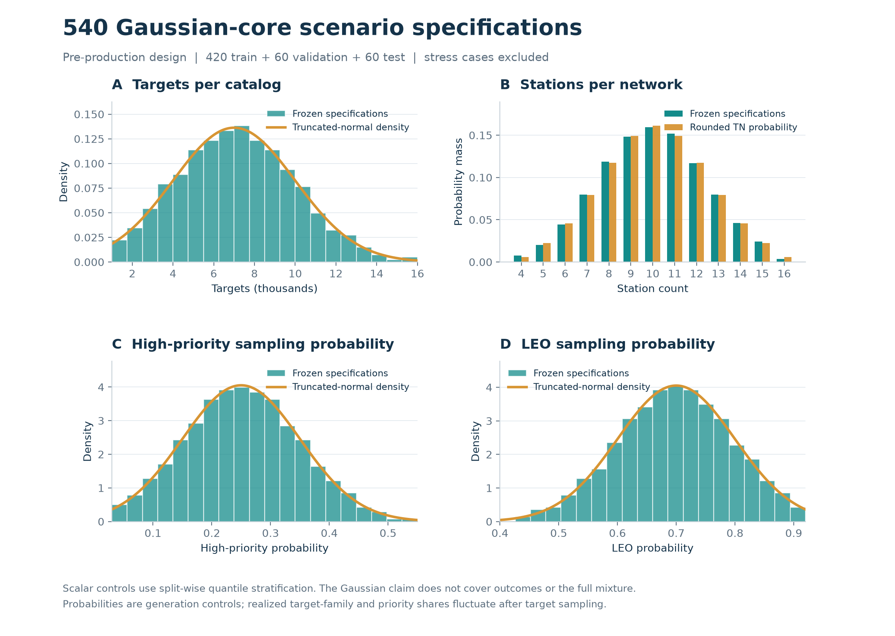
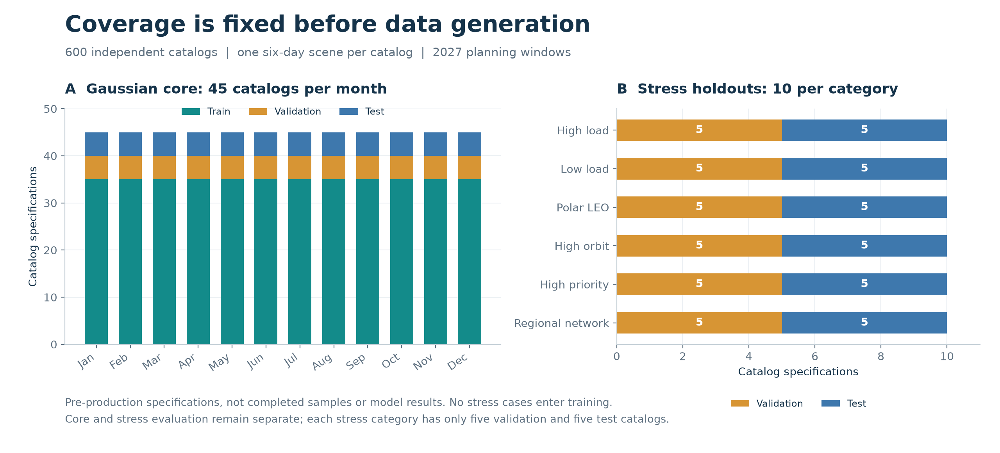

# 空间目标观测调度合成数据集 synthetic-v0.2

本数据集把一个完整调度实例定义为一个独立合成轨道目录（catalog）及其唯一场景（scene）：给定空间目标、观测站、优先级、六天时间范围和约束，先计算可见窗口，再生成候选、教师选择标签和观测计划。它支持静态候选排序预训练、规则蒸馏、跨场景评估，以及后续强化学习环境初始化。

**生产与发布状态（待正式实测回填）：{{V2_PRODUCTION_STATE}}**

600 个目录和 4,334,032 个目标是冻结规格中的计划规模。正式完成数量、通过的校验报告、失败和耗时须按本页实测栏及审计证据核对；在这些记录回填前，不能宣称 600 场景已经完成或 1,200 份计划已经通过校验。生成提交（待回填）：`{{V2_GENERATION_COMMIT}}`。

## 版本变化和规模

v0.1 有 30 个独立目录，每目录四个变体；v0.2 使用 600 个独立目录、每目录一个场景，增加的是独立轨道与场景配置，不是对原有数据复制或换标签。v0.1 的文件、划分和 Release 不改写。v0.2 使用全新种子，发布审计还要求逐轨道检查三个划分间及与 v0.1 间的参数指纹无重复。

| 划分 | 主体目录 | 压力目录 | 总目录／场景 | 规格目标总数 | 小规模 <4,000 | 中规模 4,000–9,999 | 大规模 ≥10,000 |
|---|---:|---:|---:|---:|---:|---:|---:|
| train | 420 | 0 | 420 | 3,004,421 | 59 | 294 | 67 |
| validation | 60 | 30 | 90 | 658,937 | 18 | 53 | 19 |
| test | 60 | 30 | 90 | 670,674 | 15 | 55 | 20 |
| 合计 | 540 | 60 | 600 | 4,334,032 | 92 | 402 | 106 |

上表全部来自冻结输入规格，**不是已成功生成的统计**。每个场景使用整个所属 catalog，因而成功完成后“独立目标总数”和“场景目标实例总数”应相同。TLE 的合成 `satnum` 可在不同 catalog 重复，不是真实 NORAD 身份；全局目标键为 `(catalog_id, target_id)`。

实际完成与候选数量（待完整生产、审计后回填）：

{{V2_ACTUAL_COUNTS}}

## “常见情况多、极端情况少”的具体含义

**截断正态约束仅用于主体场景事前控制参数的边际分布。** 它不约束观测得分、内部质量 Q、任务成功率、可见窗口数或 20 维候选特征；这些量由轨道几何、资源竞争和教师实际求解产生，保留其真实生成分布。整个数据集混合了不同轨道族、月份和压力组，不能称为单一正态总体，也没有证明与真实业务分布一致。

记 `TN(μ, σ, [a,b])` 为支持区间 `[a,b]` 内重新归一化的正态分布，采用逆 CDF 抽样，不是把越界样本剪到边界。主体的每个 split、每个控制参数分别划分等概率区间，各区间抽取一次后独立打乱，以保证有限目录数下的边际覆盖。该分位数分层设计不是普通独立同分布抽样，不能套用普通 IID 正态性检验的 p 值来宣称“符合真实分布”。目标和站点数由潜在连续值四舍五入得到。

| 主体控制量 | 分布 `(μ, σ, [a,b])` | 对实际场景的含义 |
|---|---|---|
| 目标数 | `(7000, 3000, [1000,16000])` | 四舍五入后的独立目标数量 |
| 站点数 | `(10, 2.5, [4,16])` | 四舍五入后的单任务资源数量，不额外虚构多通道容量 |
| LEO 抽样概率 | `(0.70, 0.10, [0.40,0.92])` | 逐目标轨道族抽样概率，非强制精确计数 |
| 其余目标中 MEO 概率 | `(0.65, 0.12, [0.25,0.90])` | `P(MEO)=(1−P(LEO))×此值`，剩余为 GEO-like |
| 高优先级概率 | `(0.25, 0.10, [0.03,0.55])` | 逐目标取高优先级 5 分的概率 |
| 其余目标中中优先级概率 | `(0.40, 0.10, [0.15,0.75])` | 剩余目标按此概率取 3 分，其余 2 分 |
| LEO 平均半长轴高度均值/km | `(1000, 180, [650,1450])` | 再作为该 catalog 内 LEO 轨道分布的均值 |
| LEO 倾角均值/° | `(65, 20, [20,105])` | 再作为该 catalog 内 LEO 倾角分布的均值 |



*事前规格图。直方图由 540 个主体规格绘制；站点数与四舍五入后的理论离散概率质量函数比较。高优先级与 LEO 图显示控制概率，不是生成后实际目标比例。60 个压力场景不进入这些拟合对照。*

`sampling-report.json` 已对事前规格检查目录数、种子、范围、分位数分层、月份与规模配额。每个主体参数/split 的最大经验 CDF 偏差门槛为 `1/n + 1e−12`，其中 train 的 `n=420`、validation/test 主体的 `n=60`；每个等概率层恰好一个点，潜在值逆推 CDF 与记录的分位数误差不超过 `1e−12`。整数站点数的分布应与舍入后的 PMF 比较，不能直接套连续正态曲线。规范规格的紧凑 JSON SHA-256 为 `52f2b3af32c95aa8769dfb24cb7691ae586db33008ea515c80c63a4cab04d4a3`。

### 月份、网络及压力组

主体在 2027 年每个月恰有 train 35、validation 5、test 5 个场景；每段六天规划期完整落在所选月份内，起始时刻为 UTC 零点，TLE 历元设在中点。月份使用均衡配额，周期轨道角使用均匀分布，不用正态分布描述周期变量。

站点从 24 个**虚构陆地区域锚点**中选择。主体网络至少包含南、北半球各一站，其余无放回选择，再给经纬度加入 `TN(0,0.02,[−0.06,0.06])°` 扰动、站高加入 `TN(0,20,[−60,60]) m` 扰动。这些高度是设计假设，未经地形数据库或设备资料核对；锚点不代表真实可用台站。各场景的新组合扩大资源差异，但并不是对未知地理区域的严格留出测试。

| 压力标签 | 预先指定的变化 | validation / test |
|---|---|---:|
| `high_load` | 约 13,500 目标、约 5 站；目标支持 11,000–16,000，站点 4–7 | 5 / 5 |
| `low_load` | 约 2,000 目标、约 14 站；目标支持 1,000–3,500，站点 12–16 | 5 / 5 |
| `leo_polar` | LEO 概率 0.93–0.99；LEO 倾角分布支持 75°–110° | 5 / 5 |
| `high_orbit` | LEO 概率 0.20–0.40，提高中高轨占比 | 5 / 5 |
| `high_priority` | 高优先级概率 0.60–0.90 | 5 / 5 |
| `regional_network` | 仅用七个亚洲锚点选 4–7 站、固定 6 月、6,000–12,000 目标 | 5 / 5 |

压力配置的均值、标准差及其余参数详见[采样协议](PROTOCOL.sampling.md)。每类每个划分只有 5 个目录，适合发现失效情形，不足以精确估计所有极端业务的概率。多个条件可能一起变化，不能解读为单因素因果效应。训练集中没有这 60 个压力目录；调参只用 validation，test 保持锁定。



*固定配额图，非生成或模型结果。主体与压力组需分别统计质量和耗时，不能混在一起声称同分布泛化。*

### 轨道物理约束

每类轨道采用各自的有界分布。下表的高度是平均半长轴减去 6378.135 km，不是整个传播期中的真实离地高度；这些参数没有拟合真实卫星群体。

| 轨道族 | 平均半长轴高度/km | 偏心率 | 倾角/° |
|---|---|---|---|
| LEO | `TN(场景均值,250,[550,1800])` | `TN(0.004,0.003,[0.00005,0.012])` | 主体 `TN(场景均值,12,[0,120])`；极轨压力组另定 |
| MEO | `TN(17000,4000,[8000,26000])` | `TN(0.025,0.020,[0.0001,0.08])` | `TN(55,20,[10,100])` |
| GEO-like | `TN(35786,300,[34500,37000])` | `TN(0.005,0.006,[0.00001,0.025])` | `TN(5,5,[0,25])` |

升交点赤经、近地点幅角和平近点角分别在 `[0°,360°)` 均匀抽样。LEO 的 B* 使用 `TN(1.2e−5,0.8e−5,[1e−7,5e−5])`，中高轨置零。GEO-like 指近同步高轨类别，不保证全部为赤道上空的严格地球静止卫星。

使用 WGS72 平均要素初始化 SGP4，导出 TLE、检查校验和后回读；正式窗口计算与原生输入读取使用回读 TLE。历元位于规划期中点，平均要素近地点高度至少 450 km，并检查历元传播返回码与位置/速度有限性。窗口传播中的异常继续保留；不通过的轨道不能换种子悄悄替换。SGP4/TLE 本身有模型及量化误差，逐秒校验不构成真实飞行任务的高精度定轨保证。[SGP4 方法依据](SOURCES.md)

## 场景生成和教师预算

1. 从冻结规格生成独立轨道、站点和优先级；导出原生输入并重新读取，再用共同核心的 30 秒网格计算完整可见窗口。所有输入目标均保留，包括没有窗口或最终未覆盖的目标。
2. 每目标按日×站点分层选取最多 12 个窗口，保存候选池及其到完整窗口的索引。完整窗口另外保存。少于 12 个时全部保留；池外窗口不是“物理不可观测”。
3. 固定运行 3 轮价格协调预处理，再提取 20 维特征，以本地已演化规则排序并贪心放置，**不运行局部搜索**。这里的价格指站点时间资源的竞争代价，不是货币。3 轮只是固定预算，不保证收敛；本轮也没有云端伐谋调用。
4. 一个候选是“某目标在某站点的池内窗口观测某种时长”；时长为 4–8 个 30 秒格，即 120、150、180、210、240 秒，开始时刻由放置器决定。记录教师网格状态的实际窗口、时长和插入顺序，再执行 `near=False` 整数秒精修，不补入附近新窗口。
5. 网格与精修计划各自经独立 Skyfield 在 1 秒间隔及端点检查。唯一允许的修复是删除一次被标为非法的任务，保留原计划与报告，再完整校验；空计划、结构故障或再次失败阻止正式发布。

完整窗口、保留池、网格教师计划和最终计划是不同对象，不能互相冒充。教师在短表中的选择既不是全窗口最优解，也不保证等于更高预算规划档位的结果。神经网络模仿该教师不自动意味着超过原规划器。

| 规则 | 本版本口径 |
|---|---|
| 站点仰角 | 整段观测 10°–85° |
| 夜间与受照 | 站点太阳高度低于 −6°；目标不在球形地球本影内 |
| 观测时长 | 生成器使用 120–240 秒；240 秒为得分饱和点 |
| 资源与切换 | 每站同时至多一项观测，相邻任务至少 30 秒切换 |
| 重访 | 同目标跨站合并，前次结束到下次开始至少 48 小时 |
| 优先级 | 高/中/低为 5/3/2 |
| 不建模项 | 天气、目标亮度、仪器探测阈值、月光规避和真实设备状态 |

完整规则及边界解释见[规则口径](../../../规则口径.md)。独立校验重新计算几何，不把规划器窗口当作真值；仍然使用同类 SGP4 轨道模型，独立性不等于另一套高精度动力学真值。精确时间旋转缓存仅复用校验器自己计算的 Skyfield 结果，不减少采样密度；参考等价检查见[预生产证据](evidence/validator-cache-verification.json)。最终 1,200 份计划是否通过，要看正式审计，不能由缓存单元测试代替。

## 20 维静态候选特征

列顺序与公共 [`obsplan.famou_h_eval.FEATURES`](../../obsplan/famou_h_eval.py) 相同。窗口数、稀缺度、冲突与价格相对于**保留候选池**计算；时间格为 30 秒。特征先保留小数点后 4 位，规则以 float64 计算，发布数组以 float32 压缩保存；训练输入不承诺逐位重现原规则浮点结果。

| 序号 | 列名 | 解释 |
|---:|---|---|
| 0 | `priority` | 目标优先级原始分，取 2、3 或 5。 |
| 1 | `duration_cells` | 候选观测持续格数；乘以 30 才是观测秒数。 |
| 2 | `task_score` | 该时长的一次观测原始分，不包含首次覆盖价值。 |
| 3 | `cover_value` | 首次覆盖价值换算到任务得分尺度的常数 `vc / vs`。 |
| 4 | `price_cost` | 在窗口内放置该时长所需的最低资源价格成本，换算到任务得分尺度。 |
| 5 | `price_per_cell` | `price_cost / (duration_cells + 1)`，对应公共放置器的占用格计价。 |
| 6 | `window_cells` | 窗口末端与起端的格索引之差。 |
| 7 | `slack_cells` | `window_cells - duration_cells`，表示窗口相对候选时长的余量。 |
| 8 | `target_windows` | 目标在该场景保留池内的窗口数，不是完整几何窗口数。 |
| 9 | `scarcity` | `1 / (1 + remaining)`；`remaining` 为当前窗口结束后才开始的同目标窗口数。 |
| 10 | `urgency` | `1 / (1 + next48)`；`next48` 为当前窗口结束后 48 小时内开始的同目标窗口数。 |
| 11 | `conflict` | 窗口内平均候选窗口负载，再除以场景中的最大平均负载；是静态拥挤度代理。 |
| 12 | `night_pos` | 窗口中点在所属夜间区段的相对位置，约 0/1 对应黄昏/黎明，0.5 对应区段中部。 |
| 13 | `time_frac` | 窗口起点格索引除以场景采样格数，表示规划期内的相对时间。 |
| 14 | `max_obs` | 公共问题对象对该目标给出的观测次数上限，不是已执行次数。 |
| 15 | `sub_pick` | 按当前价格独立求解该目标时，其选择的观测是否落在当前站点窗口内；0/1。 |
| 16 | `sub_pick_same_duration` | 上述独立选择是否同时与当前候选时长相同；0/1。 |
| 17 | `sub_count` | 当前价格下，该目标独立子问题选择的观测次数。 |
| 18 | `target_dual` | 当前价格下该目标子问题的价值，经 `vs` 换算到任务得分尺度；不等于合法全局计划得分。 |
| 19 | `window_demand` | 所有目标的独立子问题请求在当前窗口内形成的平均资源需求。 |

价格与子问题特征需要实际预处理，端到端速度比较必须计入这些成本。以上是规划前的一次静态快照，不编码每次决策后的已覆盖目标、资源占用、合法动作集合或下一状态；也没有要求这些特征服从正态分布。

## 数组、标签与索引

`actions.npz` 不使用 pickle。令 `C` 为候选数、`T` 为发布网格计划的任务数：

| 字段 | 类型与形状 | 语义 |
|---|---|---|
| `features` | float32，`[C, 20]` | 上述静态候选特征。 |
| `candidate_window` | int32，`[C]` | `pool_windows.npz` 的窗口索引。 |
| `candidate_duration_cells` | int16，`[C]` | 候选观测格数，4–8。 |
| `rule_score_uncovered` | float32，`[C]` | 本地规则输出的目标未覆盖时分数。 |
| `rule_score_covered` | float32，`[C]` | 目标已覆盖时的原始规则分；公共恢复器实际使用 `min(uncovered, covered)`。 |
| `grid_selected` | bool，`[C]` | 是否至少被教师选择一次。 |
| `grid_selected_count` | int32，`[C]` | 该候选实际被放置的次数；长窗口中可能多次放置。 |
| `grid_selection_rank` | int32，`[C]` | 首次放置在网格计划中的零基任务顺序；未选中为 −1。 |
| `grid_start_s` | int32，`[C]` | 首次放置相对场景起点的秒数；未选中为 −1。 |
| `grid_duration_s` | int32，`[C]` | 首次放置的观测秒数；未选中为 −1。 |
| `grid_task_candidate` | int32，`[T]` | 每条网格任务对应的候选 ID，保留重复选择；长度是任务数，不能按候选行切片。 |

`grid_selected=0` 只表示固定教师未选中，不能当作“非法动作”或“没有价值”的标签。`grid_selected_count.sum()` 等于发布网格任务数；长窗口中同一个候选可被多次放置，候选级 rank/start/duration 只保留首次放置。`grid_task_candidate` 是任务级映射，不能与候选行一起切批。

`grid_plan.npz`、`plan.npz` 都包含 `station`（int16）及 `target/start_s/dur_s/candidate_id/source_grid_row`（int32），数组长度为各自计划任务数。`candidate_id` 指向 `actions.npz`；最终秒精修时长不必等于候选格数乘 30。**`source_grid_row` 指向删除修复前原始教师的插入顺序，不是发布网格计划的直接行号**；两份计划可能分别修复，需按这个键关联。`grid_selection_rank` 则与发布后的网格计划对齐。

`candidate_window` 指向场景 `pool_windows.npz`，通过 `pool_source_indices.npz.catalog_window_id` 才能映射完整 catalog 窗口。v0.2 的场景和 catalog 站点完全一致，`base_station_indices=range(n_stations)`；`targets.npz.station_anchor_id` 记录各站选中的虚构锚区。新增采样字段完整保存在 `catalog.json` 和 `manifest.identity.catalog_specs`。

```text
dataset-root/
├── manifest.json
├── events.jsonl
├── catalogs/{catalog_id}/
│   ├── catalog.json
│   ├── targets.npz
│   ├── windows.npz                 # 完整几何窗口
│   └── COMPLETED.json              # catalog+scene 完成事务身份与文件清单
├── scenes/{catalog_id}-v0/
│   ├── scene.json
│   ├── input/                     # 轨道、站址、低/中/高优先级原生文本
│   ├── pool_windows.npz
│   ├── pool_source_indices.npz
│   ├── actions.npz
│   ├── grid_plan.npz
│   ├── plan.npz
│   ├── grid_geometry.npz
│   ├── final_geometry.npz
│   └── validation.json
└── failures/{catalog_id}/attempt-*/ # 如有：保留中断或失败的原始文件
```

有删除修复时保留 `{grid|final}_before_repair*` 文件。失败目录里的部分候选和计划不属于成功训练样本；正式加载器只读取 `manifest.scenes` 中完成的场景。校验几何数组保存每任务仰角/太阳高度极值及非法标记，不保存完整逐秒轨迹。字段、单位与关联见 [schema.json](schema.json)。

## 下载、审计和可恢复性

发布下载命令及 NumPy 批次示例见 [README.md](README.md)，必须用 `--index datasets/synthetic-v0.2/release-assets.json`。发布 tag 是 `synthetic-data-v0.2`，规划为每 10 个目录一片，共 60 数据分片加 1 元数据分片；分组按冻结目录 ID 顺序确定，不能按先完成的目录选择。元数据片仅含 `manifest.json` 与 `events.jsonl`；文档、许可、schema、资产清单和审计摘要随 Git 交付。生产缓存和 DE421 星历不入分片。

严格审计还需一份已发布 v0.1 数据作为轨道不复用的参照。下面假定两个版本已按各自清单下载到不同目录；审计输出必须放在数据根目录之外的新文件，不能改动被校验的资产：

```bash
uv run python -m obsplan.training_data.v2_audit outputs/synthetic-v0.2 \
  --v1-root outputs/synthetic-v0.1 \
  --output outputs/synthetic-v0.2-independent-audit.json
```

审计重新核对规格、SHA-256、原生输入、跨目录及 v0.1 轨道指纹、数组索引、标签与计划、分数和保存的校验证据，**不会重新运行 Skyfield**。正式发布必须完成构建并通过完整非 pilot 审计；加载冒烟检查和代表性校准都不能代替该门槛。

生成采用每 catalog 独立事务、每进程 Numba/BLAS 一线程、窗口最多一个子进程；总并发数由正式身份记录。中断只可在相同规格、代码、协议、依赖和种子下恢复，保留所有 attempt，完成事务用 marker 和哈希导入，物理/算法失败不自动换种子或抹去重跑。所有完成、失败和中断文件纳入清单；不把校准目录计入正式数量。

正式生成前，10 个预先选定、未缩小规模的校准目录已完成：77,217 个目标、4,225,328 行候选，网格和最终计划各 62,086 项任务，修复 0、失败 0；完整校准审计通过，且与 v0.1 的轨道指纹隔离检查通过。首个开始至最后完成为 264.845 秒，分阶段并行时间不可直接相加。此处校准标记为 `pilot=true`，不算作正式 600 个完成场景；其 `sampling_report` 会提示仅 10 个目录不足以满足全量配额，不代表正式分布审计已完成。[校准审计](evidence/calibration-audit.json)和[完成后恢复不改写验证](evidence/calibration-resume.json)分别保留。

生产身份与依赖（待回填）：{{V2_IDENTITY_SUMMARY}}

随机种子与程序配置可以复核输入、候选和计划，跨平台浮点和计时不承诺逐位一致；运行日志时间会改变，不能要求重建压缩包与原包字节相同。发布 SHA-256 的用途是验证下载与已审计发布资产一致。

## 怎样用来训练与评估

**适合先做小型 MLP 候选排序或选择倾向预测。** 输入是 20 维静态特征，输出交回共同合法放置器；与相同池、价格预处理、放置和精修条件下的本地规则及人工贪心比较。类别比例可能不平衡，不能只报告总体准确率；应同时看正类精确率/召回率或排序指标，以及完整场景覆盖、原始分、Q、合法性和端到端时间。

对 10 个精选校准目录的只读统计发现：4,225,328 行候选中正例为 1.4694%，全部预测“不选”也能得到 98.5306% 准确率；296 组完全相同的 float32 特征同时对应选中和未选中标签。这提示静态表示遗漏了部分决策上下文，也可能涉及特征取整，不能仅靠扩大行数消除。相同特征不代表同一目标／窗口，不应盲目去重。这些比例只属于精选校准集，不能外推为正式总体；[统计证据](evidence/calibration-nn-quality.json)保留逐场结果。

建议预先固定 **40/100/200/420 个 train catalog 的嵌套子集**做学习曲线，按规模与月份分层，小子集全部包含在更大的子集中；不能把同场景的候选行随机拆分到 train/test。每个子集只用自身的 train 行单独拟合 normalizer，再用于相同的 validation 集；若用完整 420 组拟合的 normalizer，就不能宣称这是“仅用 40 组”的纯样本效率结果。当前加载器的 `fit_normalizer()` 默认扫描全部 train，子集实验需额外限定输入目录清单，不应直接复用 README 的全量标准化示例。

每档至少用 **3 个训练随机种子**起步，在固定 validation 场景上按 scene 配对比较，并报告跨种子的波动。主学习曲线保持相同梯度步数、批量大小和评测流程，另补每档充分收敛后的曲线，同时记录训练步数和实际耗时，避免把更多数据与更多训练计算混为同一种收益。训练配置和选择标准应在读取 test 结果之前固定；这些是后续实验建议，本轮没有执行神经网络训练。

大量候选行共享几何、资源和教师，样本相关性很强；4 百万目标、若干候选行不能等同为相同数量的独立调度实例。只有实际学习曲线才能回答还需要多少场景。

**动态策略网络和价值网络仍需环境或轨迹。** 本版本可提供输入实例、静态编码预训练和教师偏好蒸馏，但没有完整的 `state/action/reward/next_state/done/legal_action_mask`。策略应看到当前占用资源和已覆盖目标；价值网络要学习当前部分计划的后续回报，不能直接把最终计划 Q 当作每个候选或每个中间状态的正确价值。后续需定义状态转移、动作映射、奖励、终止条件，并用共同约束产生和验证轨迹。

Transformer 可进一步处理候选集合或目标/站点关系，MCTS 可在合法转移环境中搜索；这些组件不会自动补上缺失的动态监督。网络更大或数据更多不保证超越教师或达到 SOTA。模型排名只在明确的候选池、实例分布和预算中成立。

主体 test 与六类压力 test 应分别报告，并按 catalog 汇总误差和不确定性，不能将几百万相关候选行当作独立样本计算过窄的置信区间。压力组只用于有限的分布偏移检查，合成站点也未验证现实可用性；本版本不证明真实业务泛化。教师排序规则曾在原赛题数据上演化，因此原赛题不能对整个方法开发过程宣称完全未见测试集。

## 实际质量、计时与交付证据

每个场景记录目标数 `N`、独立覆盖数 `C`、原始累计观测分 `S` 和内部质量：

$$
Q=\frac{1}{2}\frac{C}{N}+\frac{1}{2}\frac{S}{\sum_i P_i}.
$$

`P_i` 是该场景各目标优先级分。满足 48 小时间隔的重复观测可以增加 S，因此 Q 不强制限制在 [0,1]；它是内部指标，不是官方最终成绩，也不使用原赛题固定分母 10000/30062。

计时需保留输入生成、完整窗口、教师各阶段、秒精修、独立校验、场景及 catalog 墙钟时间。多进程并发下各目录时间相加不等于整批历时；本数据生产不是算法速度排行榜，不能把不同供电、并发、机器或缓存条件的记录混排为提速证据。

正式独立校验记录（待回填）：{{V2_VALIDATION_SUMMARY}}

质量与阶段时间汇总（待回填）：

{{V2_QUALITY_TIMING_SUMMARY}}

失败、超时、中断、修复记录（待回填）：{{V2_FAILURE_SUMMARY}}

资产及发布记录（待回填）：{{V2_RELEASE_SUMMARY}}

全资产匿名下载、解压、审计和加载结果（待回填）：{{V2_PUBLIC_VERIFICATION}}

原始协议门槛保持不变，不按结果重新选 seed、删掉困难场景或降低通过标准。原创合成数据按 [CC BY 4.0](DATA_LICENSE.md) 发布；方法与外部来源见 [SOURCES.md](SOURCES.md)。
