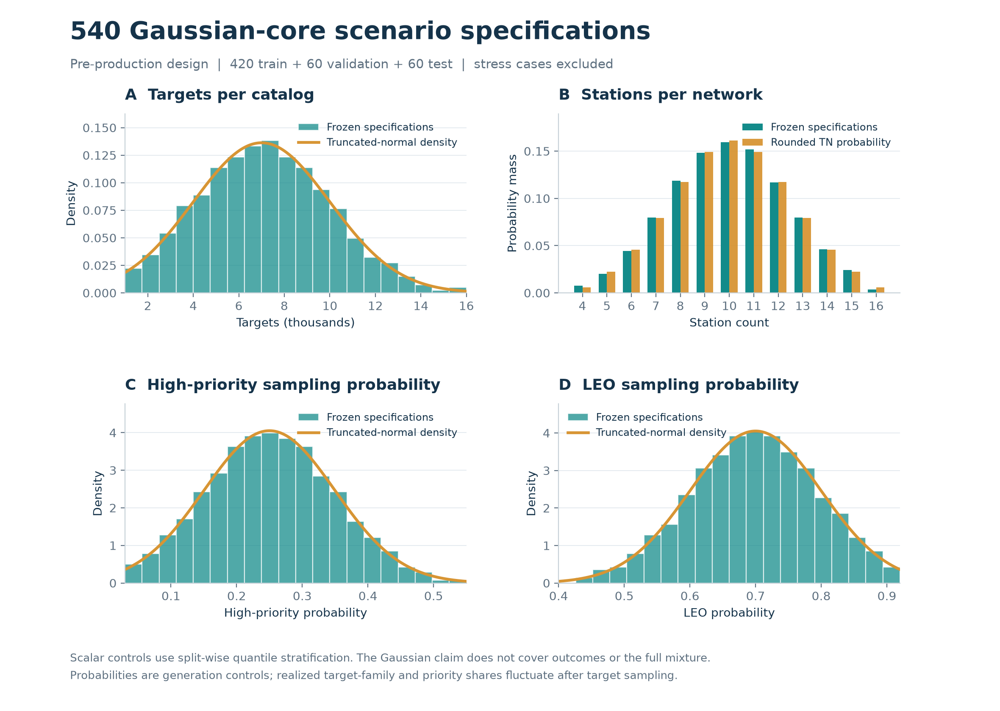

# synthetic-v0.2：600 个独立观测调度场景

面向地面光学站观测空间目标的**静态候选排序预训练、规则蒸馏和调度基准**。输入为合成轨道、站点、优先级与六天规划期；计划由本地固定预算教师生成，再通过独立 Skyfield 逐秒校验。当前数据不包含完整强化学习状态转移，也不代表已经训练出神经网络。

每组保留原题形式的输入：**数据（站址＋TLE 轨道）＋优先级（高／中／低目标名单）**。五份文本位于 `scenes/<scene_id>/input/`，文件名分别为 `站址.txt`、`轨道.txt`、`高优先级目标.txt`、`中优先级目标.txt`、`低优先级目标.txt`。优先级是输入，教师选择标签和观测计划是附加训练数据。

**生产与发布状态：正式 600/600 个独立目录与场景已完成并通过完整审计；独立目标 4,334,032、候选行 233,961,952。公开发布与匿名下载状态见后文证据。**

## 事前规格

- 600 个独立轨道目录，每目录一个场景；train / validation / test 为 **420 / 90 / 90**，不以同轨道的多个变体扩充独立样本数。
- 540 个主体场景采用有界的截断正态控制参数；60 个压力场景独立标记，分布在 validation/test，各类各 5 个。不强行把得分、质量、成功率或 20 维特征变成正态。
- 目标数支持范围 1,000–16,000，站点数 4–16；冻结规格中的目标总数为 **4,334,032**。这是生成前的配置总数，实际完成数见数据卡。
- 覆盖 2027 年 12 个月、三类轨道、24 个虚构站点锚区、多种目标优先级比例及六类压力情形；不宣称拟合了真实任务出现概率。
- 完整几何窗口保留；教师每目标最多 12 个窗口、固定 3 轮价格协调、使用本地已演化规则，无局部搜索，最后按整数秒精修。
- 每个候选包含 20 维静态特征及网格教师选择标签。两份计划各做独立 1 秒校验；**1,200 份通过报告是发布门槛，实际通过数量以正式审计为准**。



*图中是冻结场景规格与理论分布对照，不是模型结果，也不是已完成数据量。高优先级和 LEO 比例表示抽样概率，实际生成比例会有有限样本波动。*

## 下载和读取

该版本通过公开项目 [space-observation-planner](https://github.com/Mercury-LH/space-observation-planner) 的 `synthetic-data-v0.2` Release 分发；v0.1 保持原样。完整包包含 60 个数据分片（每片 10 个目录）和 1 个元数据分片。下面的命令用于下载公开版本；实际上传和完整匿名下载复核记录见 [Release 发布说明](https://github.com/Mercury-LH/space-observation-planner/releases/tag/synthetic-data-v0.2)，资产清单本身不代表下载复核已经完成。

```bash
git clone --branch synthetic-data-v0.2 https://github.com/Mercury-LH/space-observation-planner.git
cd space-observation-planner/方案H初版
uv sync --frozen
uv run python -m obsplan.training_data.download outputs/synthetic-v0.2 \
  --index datasets/synthetic-v0.2/release-assets.json
uv run python -m obsplan.training_data.loader outputs/synthetic-v0.2 --smoke
```

必须显式传入 v0.2 的 `--index`；下载器的历史默认值仍指向 v0.1。下载器检查每片 SHA-256 后解压，不需要云端伐谋或 PyTorch。`--smoke` 先扫描全部 train 拟合标准化，再读取每个划分的一批；它是加载检查，不是完整测试集评测。

仓库同时提供 [normalizer.json](normalizer.json)，仅使用 420 个训练目录的 163,183,161 条候选拟合。全量训练可用 `Normalizer.load(...)` 加载；若做 40／100／200 目录的学习曲线，应在各自训练子集重新拟合，避免把全训练集统计用于宣称小样本效果。

```python
from obsplan.training_data.loader import DatasetReader

reader = DatasetReader("outputs/synthetic-v0.2")
normalizer = reader.fit_normalizer()  # 只在 train 拟合
for epoch in range(10):
    for batch in reader.iter_batches(
        "train", batch_size=4096, normalizer=normalizer,
        shuffle=True, seed=2026 + epoch,
    ):
        x = batch["features"]       # [B, 20]
        y = batch["grid_selected"]  # 教师是否选择；不是物理合法性标签
        # 在这里调用训练代码；加载器本身不会训练模型。
```

## 证据和说明

| 文件 | 用途 |
|---|---|
| [DATASET_CARD.md](DATASET_CARD.md) | 分布、特征、标签、用途限制、实际规模与质量/时间记录 |
| [PROTOCOL.md](PROTOCOL.md) / [PROTOCOL.sampling.md](PROTOCOL.sampling.md) | 生成前锁定的流程和验收门槛 |
| [catalog-specs.json](catalog-specs.json) / [sampling-report.json](sampling-report.json) | 全部 600 个事前规格与分布检查；不是生成完成清单 |
| [calibration-specs.json](calibration-specs.json) | 按输入规格预选的 10 个完整规模校准目录，不计入正式完成数 |
| [schema.json](schema.json) | JSON/NPZ 数据字典和数组关联 |
| [SOURCES.md](SOURCES.md) / [DATA_LICENSE.md](DATA_LICENSE.md) | 来源、方法依据和原创数据 CC BY 4.0 许可 |
| [figures/metadata.json](figures/metadata.json) | 规格图输入指纹和绘图说明 |
| [audit.json](audit.json) / [statistics.json](statistics.json) | 全量审计、实际规模、质量和生产计时；审计复核保存的逐秒证据，不重跑 Skyfield |
| [normalizer.json](normalizer.json) / [evidence/loader-smoke.json](evidence/loader-smoke.json) | 训练集标准化参数与三个划分的加载检查 |
| [release-assets.json](release-assets.json) | 61 个分片的下载地址、大小与 SHA-256 |
| [evidence/server-assets-before-publication.json](evidence/server-assets-before-publication.json) | 发布前的 GitHub 服务器资产核验；此记录不代表匿名下载已完成 |
| [evidence/anonymous-download-verification.json](evidence/anonymous-download-verification.json) | 发布后从全新缓存匿名下载全部 61 片、完整复审与加载检查的通过证据 |
| [evidence/anonymous-download-failure-01.json](evidence/anonymous-download-failure-01.json) | 首次匿名下载的网络超时及保留文件指纹；成功复核使用另一个全新目录 |

发布资产记录：本地已封存 61 个分片，共 8,932,413,791 字节；全部上传资产已通过 GitHub 服务器大小与 SHA-256 核验。公开分发及完整匿名下载复核状态见 [Release 发布说明](https://github.com/Mercury-LH/space-observation-planner/releases/tag/synthetic-data-v0.2)，服务器核验本身不代表匿名下载已完成。

匿名下载、解压、审计及加载检查已于 **2026-11-08 06:10 UTC** 全部通过：从全新缓存与解压目录、无 Authorization 请求头下载全部 61 片，逐项大小与 SHA-256 一致；完整复审结果与原审计逐字节一致；使用原训练集标准化参数，三个划分均成功读取有限 `float32 [8192,20]` 批次。证据见上表与 [Release 发布说明](https://github.com/Mercury-LH/space-observation-planner/releases/tag/synthetic-data-v0.2)。首次下载在第 5 片发生网络读取超时，已保留失败记录及部分文件；成功复核没有复用首次下载的缓存。复审检查保存的逐秒证据，没有重新运行 Skyfield。
